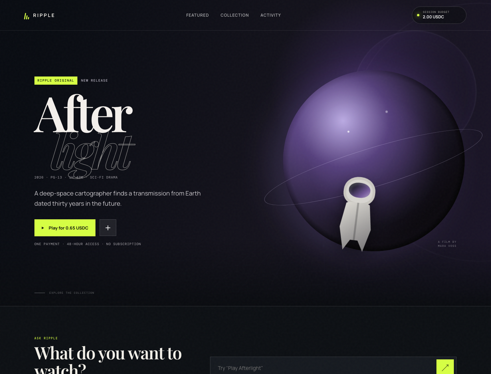
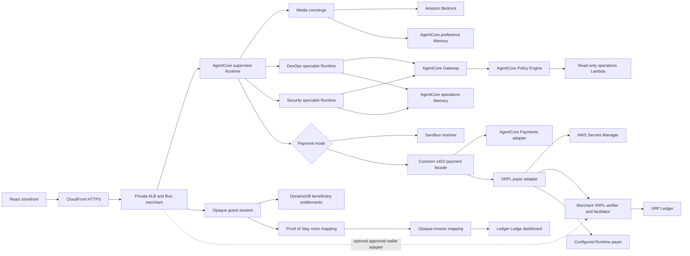

# AgentCore XRPL Guest Commerce

This sample is a Bun and React storefront that demonstrates an agent-mediated
x402 purchase. Amazon Bedrock AgentCore Runtime hosts the media concierge in
every deployment. Payment handling is selected independently:

- `sandbox` simulates either USDC or XRP without moving funds.
- `agentcore` invokes AgentCore Payments for USDC.
- `xrpl` signs and settles native XRP directly on the XRP Ledger.
- `auto` selects AgentCore Payments for USDC and direct XRPL for XRP.

> [!WARNING]
> This is sample code for non-production use. Work with your security and legal
> teams to meet your organization's security, regulatory, and compliance
> requirements before deployment. Deploying this sample creates chargeable AWS
> resources; review the [unit cost analysis](./docs/COST_ANALYSIS.md) and remove
> the environment when you finish.



> [!IMPORTANT]
> Native XRP is not processed by AgentCore Payments in this implementation.
> AgentCore Runtime orchestrates the request. In hotel/set-top mode it retrieves
> an XRPL payer seed from AWS Secrets Manager after approval and signs the
> payment. An opaque guest session receives the entitlement; the Runtime payer
> never becomes the guest identity. A five-minute invoice binds the guest,
> title, amount, network, and configured Runtime payer before settlement.
> See the [Runtime-managed payer decision](./docs/RUNTIME_MANAGED_XRPL.md).
> The public sample does not bundle a consumer browser-wallet SDK. The
> provider-neutral server contracts remain available so that an approved
> adapter can be restored by following the
> [consumer wallet restoration guide](./docs/CONSUMER_WALLET_RESTORATION.md).

The storefront also includes an AgentCore Session Inspector. Each successful
prompt shows the beneficiary-scoped memories recalled for the request, sanitized
Runtime/model/tool steps, memory write status, elapsed time, and the AgentCore
trace ID returned by `InvokeAgentRuntime`.

It also includes an Ops Copilot with isolated DevOps and Security specialist
Runtimes. The supervisor delegates operations prompts, the specialists call
read-only AWS tools through an IAM-authenticated AgentCore Gateway, and an
AgentCore Policy Engine limits each Runtime to its approved tools.
The deployed stack records its source Git commit so the DevOps specialist can
identify the running revision without repository access.

The media catalog contains 34 synthetic titles with preference metadata for
genre, mood, themes, language, subtitles, pace, runtime, ratings, price, closed
captions, and audio description. This gives AgentCore Memory enough choice to
produce visibly different recommendations for different viewers.

The deployed UI separates the consumer demo from implementation detail:

- `#storefront` contains the in-room TV discovery, playback, and payment flow.
- `#checkin` creates an opaque guest session and assigns a simulated room.
- `#hotel` contains the Ledger Lodge property dashboard and room receipts.
- `#operations` contains the DevOps/Security console, AgentCore routing,
  policies, memory inspection, findings, and execution traces.

The hotel check-in is called **Proof of Stay**. The public flow associates an
opaque guest session with one of 400 simulated rooms and binds each payment to
an XRPL `InvoiceID`. The room number never enters the public ledger. A future
consumer-wallet deployment can replace the guest session with a verified XRPL
wallet after restoring a licensed browser adapter.

The storefront catalog displays eight titles per page and can be filtered by
search text, genre, language, mood, pace, rating, and accessibility.

Discovery prompts return structured, selectable recommendations instead of
temporary prose. The initial result opens in a recommendation dialog and stays
available under the catalog's `For You` view, while `All Movies` preserves the
complete filterable library. Recommendation reasons identify when AgentCore
Memory influenced the lineup.

User guides:

- [Ops Copilot guide](./docs/OPS_GUIDE.md)
- [Security Agent guide](./docs/SECURITY_GUIDE.md)
- [Threat model](./docs/THREAT_MODEL.md)
- [Ledger Lodge hotel guide](./docs/HOTEL_GUIDE.md)
- [Consumer wallet restoration guide](./docs/CONSUMER_WALLET_RESTORATION.md)
- [Runtime-managed XRPL payer decision](./docs/RUNTIME_MANAGED_XRPL.md)
- [XRPL payment operations runbook](./docs/PAYMENT_OPERATIONS_RUNBOOK.md)
- [XRPL package and AgentCore Payments API guide](./docs/PAYMENT_BACKENDS_API_GUIDE.md)
- [AgentCore Payments MPP and the XRPL bridge](./docs/AGENTCORE_MPP_AND_XRPL.md)
- [XRPL + AgentCore extension guide](./docs/NEXT_STEPS_XRPL_AGENTCORE.md)
- [Unit cost analysis](./docs/COST_ANALYSIS.md)
- [Proof of Stay architecture slide outline](./docs/PROOF_OF_STAY_ARCHITECTURE_SLIDES.md)
- [XRP and AgentCore implementation report](./XRPL_IMPLEMENTATION_REPORT.md)

## Add trailers and playback videos

Movie metadata lives in `server/catalog.ts`. Add public trailers and paid
playback sources independently using YouTube, Vimeo, or direct HTTPS links in
`server/videoSources.ts`. The hero opens trailers without starting payment;
rented playback continues through the entitlement flow.

```ts
export const movieTrailerSources = {
  "afterlight": {
    provider: "youtube",
    url: "https://www.youtube.com/watch?v=TRAILER_VIDEO_ID",
    title: "Afterlight — Official Trailer"
  }
};

export const movieVideoSources = {
  "afterlight": {
    provider: "youtube",
    url: "https://www.youtube.com/watch?v=FEATURE_VIDEO_ID",
    title: "Afterlight"
  }
};
```

YouTube links are converted to privacy-enhanced `youtube-nocookie.com` embeds.
The player also accepts Vimeo links and direct HTTPS video files. Invalid,
non-HTTPS, or provider-mismatched links fall back to the built-in demo scene.

## What works

| Backend | Asset | Funds | AgentCore Payments required | Status |
| --- | --- | --- | --- | --- |
| `sandbox` | USDC | Simulated | No | End-to-end browser and Runtime demo |
| `sandbox` | XRP | Simulated | No | End-to-end browser and Runtime demo |
| `xrpl` | XRP | XRPL testnet/mainnet | No | Runtime-managed XRP; optional consumer-wallet contracts retained |
| `agentcore` | USDC | Connector network | Yes | Runtime facade and `ProcessPayment` adapter complete; compatible merchant verification still needs live validation |
| `auto` | XRP or USDC | Depends on asset | Depends on asset | Routes XRP to XRPL and USDC to AgentCore Payments |

`cbXRP` is not assumed to be supported by AgentCore Payments. If a future
Coinbase/AgentCore connector advertises cbXRP support, it can be added as an EVM
x402 asset without removing the native-XRP backend.

## Architecture



The CDK stack creates three Runtimes, two Memory resources, an
IAM-authenticated Gateway, a Policy Engine, the read-only operations tools,
the DynamoDB entitlement table, ECS storefront, and networking. The public
XRPL flow creates a random guest identity in an HTTP-only cookie and does not
require Cognito or a browser wallet. `enablePayments` independently controls
creation of the AgentCore Payment Manager and Coinbase connector.

The Runtime calls `@agentcore-xrpl-demo/x402-payments` for both live payer
backends. The facade validates approval, selects a compatible adapter, retries
the paid resource, and returns one result shape. The sandbox resolver remains
a demo path outside that facade. An optional consumer-wallet adapter would
bypass the Runtime payer facade while using the same XRPL merchant verifier,
settlement records, reconciliation worker, and entitlement grant.

The deployed Runtime uses a private subnet and reaches the ECS storefront
through the private Cloud Map name `storefront.agentcore-xrpl.local`. A single NAT
gateway provides the Runtime with outbound access to Bedrock, AWS APIs, and
XRPL Testnet. CloudFront supplies the managed HTTPS certificate and reaches an
internal ALB through a VPC origin. `allowedCidr` optionally restricts viewers
at the CloudFront edge. `allowedIpv6Cidrs` adds equivalent IPv6 prefixes.
`0.0.0.0/0` with no IPv6 list makes the review URL publicly dual-stack. A
restrictive IPv4 deployment with no IPv6 list disables viewer IPv6 instead of
advertising a route that the allowlist would reject. The VPC origin remains
IPv4. CDK selects Runtime subnets from a versioned list of supported stable
Availability Zone IDs and requires at least two qualifying zones.

> [!NOTE]
> The NAT gateway has an ongoing hourly and data-processing cost. Remove the
> stack when the demo is no longer needed.

The XRPL merchant and Runtime payer addresses are public configuration. The
payer seed never enters CDK context, CloudFormation parameters, or a production
environment variable. The Runtime receives only a Secrets Manager ARN and
permission to read that exact secret. It verifies that the seed derives the
configured Runtime payer address before signing.

## Payment behavior

The Runtime exposes `GET /ping` and `POST /invocations` and uses two Bedrock
tools:

- `list_catalog` retrieves titles and prices in the configured asset.
- `play_movie` requests a protected stream and handles HTTP 402.

No payment is attempted unless `approvePayment` is `true`. The Runtime also
enforces `PAYMENT_MAX_AMOUNT`, which defaults to `2` units of the configured
asset per payment.

## Session Inspector demo

The inspector makes AgentCore Memory and the execution path visible without
exposing hidden model reasoning or sensitive payment payloads.

1. Start a guest session and ask: `I prefer science fiction with captions.`
2. Wait for AgentCore Memory to extract the preference.
3. Continue with the same browser guest session and ask:
   `Pick something for me.`
4. Review the recalled preference, model and tool steps, memory write, timing,
   Runtime session ID, and AgentCore trace ID in the inspector.

The structured steps are application-level operational telemetry. The trace ID
correlates the request with the full AgentCore/CloudWatch observability data
when that account-level telemetry is enabled.

## Ops Copilot demo

The operations console demonstrates Runtime-to-Runtime delegation and
policy-controlled tools without granting either specialist mutation authority.

1. Select **DevOps Agent** and ask `Is the storefront healthy right now?`
2. Inspect the supervisor-to-specialist handoff, Gateway policy step, live
   CloudFormation/ECS tools, memory event, and specialist trace ID.
3. Select **Security Agent** and ask
   `Audit this demo for its biggest security risks.`
4. Review the live findings cards, IAM summary, passing controls, and accepted
   public-demo exposure.

See the [Ops Copilot guide](./docs/OPS_GUIDE.md) and
[Security Agent guide](./docs/SECURITY_GUIDE.md) for the complete user flow and
guardrails.

For XRP, the merchant advertises:

- x402 scheme `exact`
- network `xrpl:0`, `xrpl:1`, `xrpl:2`, or another numeric XRPL network ID
- asset `XRP`
- amount as integer drops, where 1 XRP equals 1,000,000 drops

The payer pays the XRPL network fee. The in-process facilitator does not need a
funded wallet.

The Runtime prepares XRP transactions through XRPL HTTPS JSON-RPC rather than
WebSocket. It reads the payer sequence, current fee, and validated ledger, then
sets `LastLedgerSequence` relative to the validated ledger before signing.

The public XRPL flow separates the beneficiary from the payer. The beneficiary
is the opaque guest session that owns Proof of Stay, spending state, AgentCore
Memory, and playback entitlements. The payer is the configured XRPL account
whose seed only the Runtime can read. A five-minute invoice authorizes that
payer to purchase one title for one beneficiary.

Settlement rejects a signer that differs from the configured Runtime payer.
It also rejects an invoice whose beneficiary, title, amount, network, payment
mode, or expiry differs from the current request. The
[Runtime-managed payer decision](./docs/RUNTIME_MANAGED_XRPL.md) records why
the implementation uses two identities.

## Ledger Lodge hotel demo

Ledger Lodge adds room-level context without publishing room numbers:

1. Open **Check In**. The server creates an opaque guest session.
2. Select **Assign my room**. The server atomically claims an available room
   for that guest session.
3. The server creates a random stay reference and stores the room mapping in
   DynamoDB.
4. Select **Preview TV experience** to keep the same browser session. A
   production cross-device flow requires a single-use handoff credential.
5. An x402 challenge includes a deterministic invoice binding for that stay
   and title. The XRPL client writes only its SHA-256 `InvoiceID` to the signed
   payment.
6. Open **Hotel** after settlement and refresh the ledger.
7. The dashboard reads validated incoming merchant transactions, resolves
   recognized invoice IDs through DynamoDB, and displays the associated room.

XRPL remains authoritative for the payer, destination, amount, result, time,
and transaction hash. DynamoDB supplies only the private hotel context needed
to turn an opaque invoice into a room and title. Wallet addresses are truncated
before dashboard data is returned to the browser.

The installed x402 XRPL verifier intentionally rejects arbitrary transaction
`Memos`, so the implementation uses the protocol-supported `InvoiceID`
binding instead of weakening payment verification.

## Validated Testnet flow

On October 11, 2026, an AgentCore Runtime deployment completed an end-to-end
0.65 XRP Testnet purchase. The transaction reached a validated ledger with
`tesSUCCESS`, and the merchant received the expected amount. Deployment,
wallet, transaction, and ledger identifiers are intentionally omitted from
this public sample.

```text
Result: tesSUCCESS
Amount: 650000 drops (0.65 XRP)
```

Runtime versions advance with later deployments. Use the DevOps agent or the
`SourceCommitSha` CloudFormation output to identify the revision currently
under review.

The current implementation persists sandbox sessions, guest sessions,
beneficiary entitlements, payment delegations, settlement records, transaction
claims, locks, and Proof of Stay mappings in the retained DynamoDB table. Local
development can use the in-process repository fallback. The validated ledger
remains authoritative for XRPL payment facts, even if application state or a
task is replaced.

## Prerequisites

Common requirements:

- Bun 1.4.4
- Docker with ARM64 Buildx support
- AWS CLI v2
- AWS credentials obtained through STS or an authenticated profile
- Bedrock model access in the deployment Region
- permission to bootstrap and deploy CDK

AgentCore Payments additionally requires:

- service availability in the selected Region
- a Coinbase Wallets for AgentCore Payments Marketplace subscription
- a READY Coinbase connector
- an ACTIVE user payment instrument and payment session

Live XRP additionally requires:

- a funded XRPL payer account
- the payer account's public XRPL classic address
- a merchant XRPL classic address
- an AWS Secrets Manager secret containing the payer seed

Consumer-wallet mode is not bundled. Restoring it requires a licensed
browser-wallet SDK and a funded account selected on the same XRPL network. It
does not use the payer secret stored in Secrets Manager.

## Configure AWS access

Use short-lived AWS credentials or an authenticated profile. Set the target
account and Region for your environment:

```bash
export AWS_PROFILE='<profile-name>'
export AWS_REGION='us-east-1'
export DEMO_AWS_ACCOUNT='<12-digit-account-id>'

aws sts get-caller-identity \
  --profile "$AWS_PROFILE" \
  --region "$AWS_REGION"
```

Confirm that the returned account matches `DEMO_AWS_ACCOUNT`. Do not add AWS
access keys to this repository or application environment files.

## Install and test

```bash
bun install --frozen-lockfile
bun run verify
```

`verify` runs type checking, all tests, offline CDK synthesis, and cdk-nag. The
offline synthesis uses a non-deployable account placeholder so context
providers can render a template without borrowing the developer's AWS account.
Use `bun run cdk:synth` with the real deployment account and Region before
deployment.

The test suite includes a browser-target startup smoke test. It removes
Node-only globals before loading the compiled storefront so missing browser
polyfills, such as `Buffer`, fail before deployment.

The recommended contributor flow is:

1. Create a branch and run typecheck and tests locally.
2. Open a pull request and review the exact commit to demonstrate.
3. Deploy that checkout explicitly with temporary AWS credentials.
4. Ask the DevOps agent `Which source commit is deployed?`
5. Confirm its answer matches the reviewed Git commit.

Deployment provenance improves traceability; it is not a signature or a supply
chain attestation. Production adaptations should add protected branches,
review requirements, artifact signing, and an approved deployment identity.

## Configuration

| CDK context | Default | Purpose |
| --- | --- | --- |
| `account` | Current profile | Target 12-digit AWS account |
| `region` | Current profile | Target AWS Region |
| `environment` | `demo` | Resource-name suffix |
| `sourceCommitSha` | Current Git `HEAD` | Deployed revision shown by the DevOps agent |
| `authMode` | `iam` | IAM service authorization; wallet users sign XRPL challenges |
| `enablePayments` | `false` | Create AgentCore Payment Manager and Coinbase connector |
| `paymentBackend` | `sandbox` | `sandbox`, `agentcore`, `xrpl`, or `auto` |
| `paymentAsset` | `USDC` | `USDC` or `XRP` |
| `paymentMaxAmount` | `2` | Maximum amount that one Runtime-approved payment can spend |
| `paymentSessionLimit` | `2` | Maximum cumulative storefront spend for one browser payment session |
| `usdcNetwork` | `eip155:84532` | USDC x402 EIP-155 network |
| `usdcAsset` | Base Sepolia USDC | Full 20-byte USDC token contract address |
| `usdcPayTo` | none | Full 20-byte merchant recipient; required for live AgentCore USDC |
| `xrplNetwork` | `xrpl:1` | XRPL CAIP-2 network identifier |
| `xrplHttpUrl` | network default | HTTPS JSON-RPC endpoint; required for custom XRPL network IDs |
| `xrplMaxFeeDrops` | `2000` | Maximum XRPL network fee in drops |
| `xrplReconciliationIntervalSeconds` | `30` | Settlement reconciliation interval from 5 through 3600 seconds |
| `xrplMerchantAddress` | none | Public receiving classic address |
| `xrplRuntimePayerAddress` | none | Public address derived from the Runtime payer seed |
| `xrplWalletSeedSecretArn` | none | Payer seed secret read by Runtime |
| `allowedCidr` | `0.0.0.0/0` | Optional CloudFront viewer IPv4 allowlist |
| `allowedIpv6Cidrs` | none | Optional comma-separated CloudFront viewer IPv6 allowlist |
| `modelId` | `amazon.nova-lite-v1:0` | Bedrock model or inference profile |

CDK automatically resolves `sourceCommitSha` from common CI commit environment
variables or the current checkout. A release script can override it explicitly
with `--context sourceCommitSha=<git-sha>`. If CDK is synthesized outside a Git
checkout and no value is supplied, the output is `unknown`.

Valid live combinations are:

```text
USDC: paymentBackend=agentcore, paymentAsset=USDC, enablePayments=true
XRP:  paymentBackend=xrpl,      paymentAsset=XRP,  enablePayments=false
```

Sandbox accepts either asset. `auto` requires the resources needed by the
selected asset.

## Local sandbox

USDC:

```bash
PAYMENT_BACKEND=sandbox PAYMENT_ASSET=USDC bun dev
```

XRP:

```bash
PAYMENT_BACKEND=sandbox PAYMENT_ASSET=XRP XRPL_NETWORK=xrpl:1 bun dev
```

Open `http://localhost:4173`. `/api/agent` returns 503 locally unless an
AgentCore Runtime ARN is configured, but the direct React sandbox flow works.

## Bootstrap

```bash
export DEMO_ENVIRONMENT='demo'
export DEMO_ALLOWED_CIDR='<your-public-ip>/32'
export DEMO_ALLOWED_IPV6_CIDRS='<your-public-ipv6-prefix>/64'

bunx cdk bootstrap \
  "aws://${DEMO_AWS_ACCOUNT}/${AWS_REGION}" \
  --profile "$AWS_PROFILE"
```

Review the bootstrap changes before accepting them in the target account.

## Deploy Runtime with sandbox payments

This path does not require Marketplace or Coinbase:

```bash
bun run cdk:diff -- \
  --context account="$DEMO_AWS_ACCOUNT" \
  --context region="$AWS_REGION" \
  --context environment="$DEMO_ENVIRONMENT" \
  --context authMode=iam \
  --context enablePayments=false \
  --context paymentBackend=sandbox \
  --context paymentAsset=XRP \
  --context allowedCidr="$DEMO_ALLOWED_CIDR" \
  --context allowedIpv6Cidrs="$DEMO_ALLOWED_IPV6_CIDRS" \
  --profile "$AWS_PROFILE"
```

After reviewing the diff, replace `cdk:diff` with `cdk:deploy` and include
`--require-approval broadening`. Nothing in this repository automatically
deploys the stack.

## Configure live XRP

Use XRPL testnet first (`xrpl:1`).

1. Create and fund a testnet payer account from an XRPL faucet.
2. Choose a merchant receiving classic address.
3. In AWS Secrets Manager, create a secret such as `agentcore-xrpl-demo/demo/xrpl-payer`.
4. Store either the raw seed or JSON in this form:

   ```json
   {"seed":"s..."}
   ```

5. Record the payer account's public classic address.
6. Copy the secret ARN. The seed value itself must not be supplied as CDK
   context.

Synthesize and review:

```bash
export XRPL_MERCHANT_ADDRESS='<merchant-r-address>'
export XRPL_RUNTIME_PAYER_ADDRESS='<payer-r-address>'
export XRPL_WALLET_SECRET_ARN='<secrets-manager-arn>'

bun run cdk:diff -- \
  --context account="$DEMO_AWS_ACCOUNT" \
  --context region="$AWS_REGION" \
  --context environment="$DEMO_ENVIRONMENT" \
  --context authMode=iam \
  --context enablePayments=false \
  --context paymentBackend=xrpl \
  --context paymentAsset=XRP \
  --context xrplNetwork=xrpl:1 \
  --context xrplMerchantAddress="$XRPL_MERCHANT_ADDRESS" \
  --context xrplRuntimePayerAddress="$XRPL_RUNTIME_PAYER_ADDRESS" \
  --context xrplWalletSeedSecretArn="$XRPL_WALLET_SECRET_ARN" \
  --context allowedCidr="$DEMO_ALLOWED_CIDR" \
  --context allowedIpv6Cidrs="$DEMO_ALLOWED_IPV6_CIDRS" \
  --profile "$AWS_PROFILE"
```

In live XRP mode, approve playback through `/api/agent`; the built-in payment
sheet uses AgentCore-managed signing. The Runtime seed does not enter the web
application.

```bash
curl --fail --cookie-jar guest.txt --cookie guest.txt \
  --request POST "${DEMO_URL}/api/hotel/check-in"

curl --fail --cookie-jar guest.txt --cookie guest.txt \
  --request POST "${DEMO_URL}/api/agent" \
  --header 'content-type: application/json' \
  --data '{
    "prompt": "Play Afterlight",
    "approvePayment": true
  }'
```

Use test funds only. Mainnet requires an explicit `xrpl:0` deployment and a
production review of durable entitlements, replay recovery, monitoring,
multi-instance settlement coordination, and wallet custody.

AgentCore Runtime sessions are pinned to the Runtime version on which they
start. Use a new `sessionId` after deploying a new Runtime version; omitting it
from `/api/agent` automatically creates a fresh session.

For an optional consumer experience, follow the
[consumer wallet restoration guide](./docs/CONSUMER_WALLET_RESTORATION.md).

## Configure AgentCore Payments with USDC

First complete the Marketplace subscription in the target account. Then deploy
with:

```text
enablePayments=true
paymentBackend=agentcore
paymentAsset=USDC
usdcNetwork=eip155:84532
usdcAsset=0x036CbD53842c5426634e7929541eC2318f3dCF7e
usdcPayTo=<full-merchant-evm-address>
```

CDK rejects missing, truncated, or zero-valued live USDC recipients. Sandbox
mode uses a synthetic full-length address because it never submits funds.

Open the `PaymentConnectorAuthorizationUrl` stack output and complete Coinbase
authorization. Wait until the connector is `READY`, then create an authenticated
user instrument and bounded payment session.

The Runtime passes an eligible challenge to the AgentCore adapter in
`@agentcore-xrpl-demo/x402-payments` when supplied `paymentSessionId` and
`paymentInstrumentId`. The adapter invokes `ProcessPayment`, attaches the
returned proof to the merchant retry, and normalizes the result. Before
presenting this as a live end-to-end demo, validate the Coinbase proof against
a compatible merchant settlement path configured for the selected network,
token contract, and recipient.

AgentCore Payments is optional: failing to obtain the subscription or activate
the connector does not block deployment of AgentCore Runtime, sandbox XRP, or
direct XRPL XRP.

## Stack outputs

The stack emits:

- `StorefrontUrl`
- `CloudFrontDistributionId`
- `StorefrontClusterName`
- `StorefrontServiceName`
- `StorefrontLogGroupName`
- `AgentRuntimeArn`
- `AgentRuntimeEndpointArn`
- `DevOpsRuntimeArn`
- `SecurityRuntimeArn`
- `RuntimeRoleNames`
- `ApplicationSecurityGroupIds`
- `MemoryId`
- `EntitlementTableName`
- Payment Manager and connector outputs, or `disabled`

```bash
aws cloudformation describe-stacks \
  --stack-name "AgentCoreXrplPayments-${DEMO_ENVIRONMENT}" \
  --query "Stacks[0].Outputs" \
  --output table \
  --profile "$AWS_PROFILE" \
  --region "$AWS_REGION"
```

## Security boundaries

- AWS access comes from STS/profile credentials, not static AWS keys.
- The storefront cannot call `ProcessPayment`.
- The Runtime can process AgentCore payments but cannot increase session
  limits.
- In XRPL mode, the Runtime can read only the configured payer secret.
- The storefront receives only the public merchant and Runtime payer addresses.
- Explicit approval is required before either payment backend signs.
- A restored consumer-wallet adapter must keep private keys inside the wallet;
  the demo may receive only the signed transaction blob.
- Guest sessions remain in an HTTP-only storefront cookie. A five-minute,
  single-purpose payment delegation goes only to the concierge Runtime;
  specialist invocations receive neither token nor payment authority.
- Sandbox budgets and beneficiary entitlements remain isolated in DynamoDB.
  Settlement and recovery use a lock scoped to the beneficiary.
- Proof of Stay PINs are checked server-side and are never stored in a wallet
  session, returned by an API, placed in AgentCore Memory, or written to XRPL.
- Room numbers remain in DynamoDB. The public ledger contains only an opaque
  invoice hash, and hotel APIs return the truncated Runtime payer address.
- DevOps and Security specialists run from a separate container entry point and
  IAM roles that cannot invoke payment APIs.
- Storefront ECS tasks and the load balancer are private; CloudFront reaches the
  origin through a VPC origin.
- Conversation Memory excludes wallet seeds, proofs, balances, entitlements,
  and authoritative payment state.
- AgentCore Memory namespace variables must not use reserved keys such as
  `actorId`, `sessionId`, or `memoryStrategyId`.

The direct XRPL path does expose decrypted payer seed material to the Runtime
process while signing. A production custody design should consider a dedicated
signer or HSM/KMS-backed signing service instead of a general-purpose Runtime
secret.

The demo persists `CHALLENGED → SIGNED → SUBMITTED → VALIDATED → GRANTED`
settlement state, transaction-claim deduplication, distributed payment locks,
and atomic entitlement grants. A reconciliation worker checks pending
transaction hashes every 30 seconds. CloudWatch alarms identify invalid and
repeatedly pending reconciliations.

## Repository layout

```text
.
├── agent/src/index.ts           # Concierge Runtime and payment orchestration
├── agent/src/specialist-*.ts    # Isolated DevOps/Security Runtime
├── CONTRIBUTING.md              # Contribution and validation workflow
├── docs/OPS_GUIDE.md            # DevOps agent user guide
├── docs/SECURITY_GUIDE.md       # Security agent user guide
├── docs/HOTEL_GUIDE.md          # Ledger Lodge and Proof of Stay guide
├── infra/cdk/lib/               # Stack plus reusable edge, Runtime, network, asset, and ops components
├── ops-tools/                   # Modular read-only deployment/security tools
├── packages/agentcore-xrpl-settlement/
│   └── src/                     # Application-neutral XRPL settlement package
├── packages/x402-payments/
│   └── src/                     # Common paid-resource facade and adapters
├── server/
│   ├── paymentService.ts        # Stable injected facade for payment workflows
│   ├── paymentChallengeService.ts
│   ├── managedEntitlementService.ts
│   ├── managedXrplSettlementService.ts
│   ├── sandboxPaymentService.ts
│   ├── paymentRoutes.ts         # Reusable payment HTTP route handler
│   └── ...                      # Identity, hotel mapping, HTTP, and persistence modules
├── shared/                      # Runtime contracts and XRPL utilities
├── src/hooks/                   # Storefront and payment-flow controllers
├── src/lib/contracts.ts         # Browser-side response validation
├── server.ts                    # Application composition and non-payment routes
├── test/
├── cdk.json
└── package.json
```

## Remove the environment

Delete AgentCore payment sessions and instruments before destroying a Payment
Manager. Then run:

```bash
bun run cdk:destroy -- \
  --context account="$DEMO_AWS_ACCOUNT" \
  --context region="$AWS_REGION" \
  --context environment="$DEMO_ENVIRONMENT" \
  --profile "$AWS_PROFILE"
```

The shared CDK bootstrap stack and the entitlement table are intentionally
retained. AgentCore can take up to 8 hours to release Runtime network
interfaces; if deletion fails on the VPC subnets or security group, run the
destroy command again after they are released.

## Official references

- [AgentCore Runtime service contract](https://docs.aws.amazon.com/bedrock-agentcore/latest/devguide/runtime-service-contract.html)
- [AgentCore Payments security](https://docs.aws.amazon.com/bedrock-agentcore/latest/devguide/payments-security-best-practices.html)
- [AgentCore Payment Manager CloudFormation resource](https://docs.aws.amazon.com/AWSCloudFormation/latest/TemplateReference/aws-resource-bedrockagentcore-paymentmanager.html)
- [x402 XRPL package](https://www.npmjs.com/package/@x402/xrpl)
- [XRPL testnet faucets](https://xrpl.org/resources/dev-tools/xrp-faucets)
