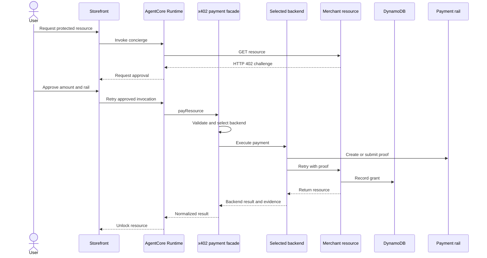

# Reusable x402 payment architecture and extension guide

## Purpose

The sample separates paid-resource orchestration from settlement rail details. A
developer can move between native XRP and Amazon Bedrock AgentCore Payments
without changing the application-level `payResource` call.

Two packages implement that design:

| Package | Responsibility |
| --- | --- |
| `@agentcore-xrpl-demo/x402-payments` | Validates the common request, selects a backend, executes the paid-resource retry, and normalizes the result. |
| `@agentcore-xrpl-demo/xrpl-settlement` | Prepares, signs, verifies, settles, validates, and reconciles exact native-XRP payments. |

The application still owns identity, approval, invoice meaning, persistence,
and the resource grant. Each backend owns proof behavior, while its merchant
and settlement system own finality.

## Current implementation

The November 5, 2026 implementation includes:

- a common `payResource` facade;
- XRPL and AgentCore Payments payer adapters;
- a native-XRP merchant verifier and facilitator;
- an opaque guest beneficiary that remains separate from the Runtime-managed
  XRPL payer;
- a five-minute invoice that binds the beneficiary, expected payer, title,
  amount, network, and Proof of Stay;
- an XRPL settlement state machine;
- DynamoDB transaction claims, locks, settlements, and entitlements;
- a reconciliation worker that runs at startup and every 30 seconds;
- two CloudWatch reconciliation alarms;
- managed-payment authorization tests with generated guest and XRPL fixture
  data;
- repository-wide typecheck and test commands.

The original Runtime-managed XRP Testnet transaction validated on October 11,
2026. The extracted packages still need a fresh deployed Testnet run before
publication.

The AgentCore Payments adapter can call `ProcessPayment` and retry a merchant
resource. The sample still needs a compatible live USDC merchant verifier before
that path qualifies as end to end.

## Design rules

### Share the paid-resource API

Both live backends use this call:

```ts
const result = await payments.payResource({
  principalId,
  resourceUrl,
  firstResponse,
  paymentRequiredBody,
  approved: true,
  idempotencyKey,
  preferredBackend
});
```

The caller receives:

```ts
interface PaidResourceResult {
  status: "resource_granted" | "merchant_retry_failed";
  response: Response;
  body: unknown;
  receipt: {
    backend: "xrpl" | "agentcore";
    providerId?: string;
    stage: "proof_generated" | "merchant_accepted" | "settled";
    details?: unknown;
  };
}
```

Application code uses `status`, `response`, and `body` without branching on
the rail. Operations code uses `receipt` for rail-specific evidence.

### Keep finality rail-specific

AgentCore Payments returns `PROOF_GENERATED` after it creates payment proof.
XRPL reaches `VALIDATED` only after the ledger includes a `tesSUCCESS`
transaction that passes payer, destination, amount, invoice, and hash checks.

The facade does not collapse those milestones into one `settled` flag.

### Keep custody behind each adapter

The XRPL adapter receives an x402 XRPL client backed by an injected signer. In
The sample's Runtime-managed flow retrieves one Secrets Manager seed
after approval and creates that signer.

The AgentCore Payments adapter receives Payment Manager, payment session, and
payment instrument identifiers. The Runtime never receives connector
credentials.

The common API does not expose a generic private-key or transaction-signing
method.

### Keep the model outside authorization

The model can request a purchase. Deterministic code enforces:

- an authenticated principal;
- explicit approval;
- an HTTP 402 initial response;
- an absolute HTTP or HTTPS resource URL;
- a non-empty idempotency key;
- backend compatibility;
- the Runtime payment limit;
- backend-specific session or signer requirements.

The facade and both adapters check approval. Direct adapter execution cannot
bypass that control.

## Runtime architecture



The Runtime selects `sandbox`, `xrpl`, or `agentcore` from deployment
configuration and the merchant challenge. Sandbox remains a demo-only resolver
outside the live-backend facade. Both live backends use
`@agentcore-xrpl-demo/x402-payments`.

The Runtime passes a 33–64 character idempotency key derived from the AgentCore
session and title. AgentCore Payments forwards it as `clientToken`. XRPL uses
the application settlement and transaction hash records for durable
deduplication.

## XRPL backend

### Payer path

`createXrplPaymentBackend` accepts only:

- scheme `exact`;
- networks beginning with `xrpl:`;
- asset `XRP`.

The adapter calls `payXrplResource`, which:

1. Parses the original 402 response and body.
2. Selects a compatible payment requirement.
3. Creates the x402 payment payload.
4. Prepares the XRPL transaction.
5. Signs through the injected signer.
6. Retries the same resource with proof.
7. Returns the merchant body and settlement receipt.

`prepareXrplPaymentTransaction` reads the validated account sequence, current
open-ledger fee, and validated ledger index. It caps the fee and sets
`LastLedgerSequence`.

### Merchant path

`XrplMerchantSettlement` creates exact-XRP challenges and provides:

- signed-payload decoding;
- matching requirement selection;
- x402 verification;
- transaction settlement.

The host validates the configured Runtime payer, guest beneficiary, configured
merchant, amount, invoice, inventory, and grant policy before it grants
application value. The payer funds the transaction; the beneficiary owns the
entitlement. See
[Runtime-managed XRPL payer decision](./RUNTIME_MANAGED_XRPL.md).

### Durable state

The sample persists:

```text
CHALLENGED → SIGNED → SUBMITTED → VALIDATED → GRANTED
     │           │          │
     ├───────────┴──────────┴──→ FAILED
     └─────────────────────────→ EXPIRED
```

The DynamoDB repository:

- locks one payment intent or payer;
- claims each transaction hash once;
- applies conditional state transitions;
- writes the entitlement and `GRANTED` state atomically;
- indexes pending records by state and update time.

The reconciliation worker calls `inspectSettlement` for pending hashes. It
grants only validated `tesSUCCESS` transactions that match every stored
invariant.

## AgentCore Payments backend

`createAgentCorePaymentBackend` requires:

- an AgentCore data-plane client;
- a Payment Manager ARN;
- a payment session ID;
- a payment instrument ID;
- an agent name;
- explicit network/asset support or a compatibility callback.

The adapter:

1. Confirms approval and backend compatibility.
2. Validates the 33–256 character idempotency key.
3. Validates that the challenge contains JSON-compatible data.
4. Sends `ProcessPayment` with `CRYPTO_X402`.
5. Requires `PROOF_GENERATED` and a proof payload.
6. Retries the merchant resource with `x-payment` and
   `payment-signature`.
7. Returns the same facade result shape as XRPL.

The adapter reports `proof_generated` when the merchant rejects the retry and
`merchant_accepted` when the merchant returns success. The
`processPaymentId` becomes the receipt's `providerId`.

The sample's default USDC challenge uses Base Sepolia (`eip155:84532`) and the
configured USDC contract. Live AgentCore Payments deployments must also provide
the full merchant recipient through `usdcPayTo`; CDK rejects missing, truncated,
or zero-valued addresses. The current Runtime accepts non-XRPL challenges as
AgentCore candidates. Production code must replace that broad rule with
connector-advertised network, asset, and scheme capabilities.

## Optional browser-wallet path

The public sample does not bundle a browser-wallet SDK. The retained contracts
support restoring consumer custody outside AgentCore Runtime:

1. The browser authenticates the wallet with a signed nonce.
2. The Runtime discovers the merchant challenge.
3. The user chooses browser signing through an approved adapter.
4. The storefront prepares the unsigned XRP transaction.
5. The wallet displays and signs the transaction.
6. The browser submits only the signed x402 payload.
7. The merchant uses the same XRPL verification, settlement, persistence, and
   reconciliation path.

The browser-wallet path does not use the Runtime payer facade. It creates a
`consumer-wallet` invoice and keeps the verified wallet as both payer and
beneficiary.

The browser-wallet path does not use the Runtime payer facade because the
browser owns signing and retry control. It shares the XRPL merchant package and
durable settlement model. See
[Restore consumer XRPL wallet support](./CONSUMER_WALLET_RESTORATION.md).

## Application-owned adapters

The reusable packages exclude product concepts. The sample supplies these host
adapters:

| Concern | Sample implementation |
| --- | --- |
| Principal | Verified `xrpl:<network>:<address>` identity or sandbox session |
| Approval | `approvePayment` plus the displayed payment sheet |
| Runtime signer | Secrets Manager seed and `createXrplWalletSigner` |
| Consumer signer | Optional approved adapter; not bundled |
| Authentication handoff | Five-minute hashed payment delegation |
| Invoice | Opaque `InvoiceID` derived from stay and title |
| Persistence | DynamoDB entitlement store |
| Lock | Conditional DynamoDB payment lock |
| Grant | Wallet-owned playback entitlement |
| Reconciliation | Startup and 30-second storefront worker |
| Alerting | Two CloudWatch alarms |

A new product replaces these adapters while retaining the payment packages.

## Extension patterns

### Paid API or download

Use the API route or dataset version as `resourceId`. Bind the invoice to one
order. Grant one API token, signed URL, or credit allocation per transaction
claim.

### Ticket or reservation

Bind the invoice to an inventory hold. Confirm the hold inside the same
transaction that creates the grant. Define refund handling for a payment that
validates after inventory expires.

### Game item

Bind the invoice to a stock-keeping unit and player account. Grant the item
once. Keep private player data outside XRPL.

### Subscription

Bind the invoice to a plan and billing period. Extend access from a
deterministic boundary. Define whether an accidental duplicate extends the
period or enters refund review.

### Another payment rail

Implement `PaymentBackend` with:

- a unique `name`;
- a strict `supports` predicate;
- direct approval enforcement;
- deterministic idempotency;
- proof creation;
- merchant retry;
- normalized response parsing;
- rail-specific evidence in `details`.

Do not add rail-specific custody fields to `PaidResourceRequest`.

## Testing

Run the repository checks through the package scripts:

```bash
bun run typecheck
bun run test
```

The `test` script excludes generated `cdk.out` asset copies.

The test strategy covers:

| Layer | Current coverage |
| --- | --- |
| Facade | Request validation, approval, backend selection, normalized results, and stable errors |
| XRPL adapter | Scheme/network/asset matching, proof-header protection, settlement reference, response parsing, and direct-call approval |
| AgentCore adapter | Capability matching, scheme allowlist, context validation, idempotency length, JSON payload validation, proof handling, merchant rejection, and text parsing |
| XRPL package | Fee cap, transaction preparation, canonical hash, state transitions, invariant checks, and reconciliation |
| Persistence | Atomic grant, duplicate transaction rejection, restart reconciliation, and invalid-ledger handling |
| Runtime | Specialist isolation, invocation validation, payment terminal states, and container paths |
| Browser | Wallet mapping, signed transaction hashing, recovery, and browser bundle startup |
| Infrastructure | Payment-resource omission, direct-XRPL deployment, CloudFront exposure, and stack synthesis |

The facade suite creates fixture addresses, identifiers, Amazon Resource Names
(ARNs), sessions, instruments, amounts, URLs, assets, proofs, and responses at
runtime. Static literals represent protocol constants or expected behavior.

Add a test whenever a new backend, state transition, header, or deployment
option changes.

## Operations and security

The supervisor Runtime owns payment execution. DevOps and Security specialist
Runtimes cannot receive:

- approval;
- payment session or instrument identifiers;
- payment delegation;
- `ProcessPayment` permission;
- XRPL signer-secret permission.

The storefront cannot call `ProcessPayment`. It creates and manages user
payment context when AgentCore Payments is enabled, then passes identifiers to
the supervisor Runtime.

AgentCore Memory stores preferences and non-authoritative operations context.
It never stores seeds, proofs, balances, approvals, entitlements, room PINs, or
settlement finality.

The XRPL operations runbook defines reconciliation, rotation, rollback, and
Mainnet gates. Operators must preserve the retained DynamoDB table through an
application rollback.

## Deployment modes

| Backend | Asset | Payment resources | Current state |
| --- | --- | --- | --- |
| `sandbox` | XRP or USDC | None | Browser and Runtime demo |
| `xrpl` | XRP | Secrets Manager payer for Runtime mode | Validated before extraction; fresh package validation pending |
| `agentcore` | USDC | Payment Manager, connector, instrument, and session | Adapter implemented; live merchant validation pending |
| `auto` | XRP or USDC | Resources required by selected rail | Routes from the merchant challenge |

Native XRP never passes through AgentCore Payments in this project.

## Publication gate

Publish the packages only after all seven conditions pass:

1. Runtime-managed Testnet payment reaches `GRANTED`.
2. An approved consumer-wallet Testnet payment reaches `GRANTED`, if that
   optional adapter will be published.
3. Lost-response recovery grants exactly once.
4. Duplicate transaction submission creates one grant.
5. Restart reconciliation processes pending records.
6. Package tests pass without public-network access.
7. Package READMEs match the exported TypeScript API.

## Production gate

Mainnet requires:

1. A reviewed custody design that removes general-purpose Runtime seed access.
2. Two XRPL providers with tested failover.
3. Alarm actions routed to an owned incident destination.
4. Tested seed rotation and application rollback.
5. Refund, limit, and exception ownership.
6. Staff authentication for the hotel dashboard or equivalent operator view.
7. A controlled release identity, artifact integrity, and branch protection.

## Related guides

- [Common payment facade](../packages/x402-payments/README.md)
- [Native XRPL package](../packages/agentcore-xrpl-settlement/README.md)
- [API comparison](./PAYMENT_BACKENDS_API_GUIDE.md)
- [AgentCore Payments MPP and the XRPL bridge](./AGENTCORE_MPP_AND_XRPL.md)
- [XRPL operations runbook](./PAYMENT_OPERATIONS_RUNBOOK.md)
- [Unit cost analysis](./COST_ANALYSIS.md)
- [Implementation report](../XRPL_IMPLEMENTATION_REPORT.md)
