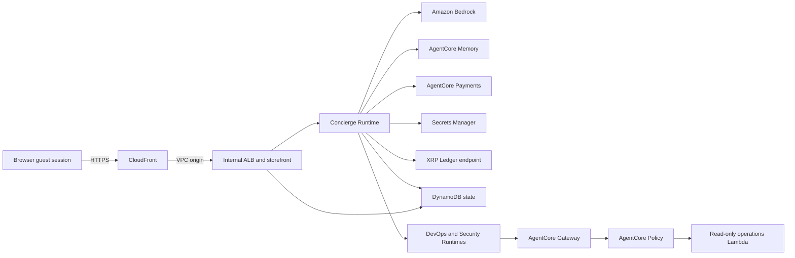

# Threat model

## Purpose and scope

This threat model covers the non-production AgentCore XRPL Guest Commerce
sample and the AWS resources created by its CDK stack. It covers the browser
storefront, merchant server, Amazon Bedrock AgentCore Runtimes, AgentCore
Memory, Gateway and Policy, operations Lambda function, DynamoDB state, container images,
AgentCore Payments adapter, and native XRP Ledger adapter.

The review assumes that builders deploy the sample into an AWS account they
control, use synthetic data, use XRPL Testnet or a connector test environment,
and remove the stack after evaluation. The sample is not designed to process
regulated data, real hotel records, production credentials, or material-value
payments.

## Security objectives

The design must:

1. require explicit approval before a payment attempt;
2. bind a payment to the expected Runtime payer, guest beneficiary, merchant,
   amount, asset, network, title, and opaque invoice;
3. prevent one guest session or wallet from receiving another beneficiary's
   entitlement;
4. keep wallet seeds and short-lived payment capabilities out of source
   control, browser storage, logs, and specialist-agent inputs;
5. restrict specialist agents to approved read-only tools;
6. keep the load balancer and Runtime network interfaces private;
7. preserve enough operational evidence to investigate payment and policy
   outcomes without recording sensitive payment material.

## Assets and data classification

| Asset | Sensitivity | Storage or handling |
| --- | --- | --- |
| XRPL payer seed | Secret | AWS Secrets Manager; read only by the concierge Runtime when direct XRPL payment is configured |
| Guest, wallet, and payment-delegation tokens | Secret, short-lived | Only hashes are stored in DynamoDB; browser sessions use secure, HTTP-only cookies |
| Signed XRPL transaction | Sensitive payment material | Submitted to the configured ledger endpoint; never sent to specialist agents |
| Payment requirements and settlement state | Sensitive operational data | Validated by the merchant and stored in DynamoDB |
| Guest beneficiary ID | Pseudonymous identifier | Random server-generated value used to scope Proof of Stay, memory, and entitlements |
| Runtime payer address | Public payment identifier | CDK configuration and invoice binding; dashboard responses truncate it |
| AgentCore Memory records | User preference or operational context | Non-authoritative context with a 30-day event expiry |
| Hotel stay and room association | Synthetic private context | Stored in DynamoDB; the public ledger receives only an opaque invoice hash |
| Source commit and deployment identifiers | Internal operational metadata | Stored in CloudFormation outputs and Lambda configuration |

## Actors and trust boundaries

Actors include an unauthenticated viewer, a guest-session holder, an optional
XRPL wallet owner, a demo operator, the storefront service, the concierge
Runtime, the isolated DevOps
and Security Runtimes, AWS managed services, an AgentCore Payments connector,
and an XRPL endpoint.

The main trust boundaries are:

1. browser to CloudFront;
2. CloudFront to the internal Application Load Balancer;
3. storefront to AgentCore Runtime;
4. Runtime to Bedrock, AgentCore Memory, AgentCore Payments, Secrets Manager,
   and the XRPL endpoint;
5. specialist Runtime to AgentCore Gateway and Policy;
6. application services to DynamoDB;
7. the AWS account to external payment and ledger systems.

## Entry points

- CloudFront viewer requests to the Bun storefront and JSON API;
- wallet challenge and signature-verification endpoints;
- concierge and specialist Runtime invocations;
- AgentCore Gateway tool requests;
- AgentCore Payments connector calls;
- XRPL JSON-RPC requests and signed transaction submission;
- CDK deployment by an authenticated operator.

## Threats and controls

| Threat | Implemented controls | Residual risk or required production work |
| --- | --- | --- |
| Wallet identity spoofing or challenge replay | The server validates the public key against the classic address, creates an origin- and network-bound nonce, consumes each challenge atomically, checks expiry, and verifies the signature. Session tokens are random, hashed at rest, and delivered in `Secure`, `HttpOnly`, `SameSite=Lax` cookies. | Add rate limits, abuse detection, and a formal session-revocation policy for production. |
| Cross-session entitlement access | Entitlements use the beneficiary, network, and resource key. A five-minute invoice binds the beneficiary to the expected Runtime payer. The grant transaction claims each XRPL transaction once. | A production authorization review must cover every new resource and tenant dimension. |
| Payment tampering | The merchant verifies payment scheme, network, destination, amount, configured Runtime payer, guest beneficiary, payment mode, title, expiry, transaction result, and opaque `InvoiceID`. Settlement transitions move forward, and a transaction cannot grant two resources. | Test every connector and ledger failure mode before accepting real value. |
| Payment replay or concurrent double spend | DynamoDB conditional writes, transaction-claim records, idempotency keys, and per-principal payment locks prevent duplicate grants within the application. | Ledger reorganization, connector-specific replay behavior, and cross-Region concurrency require production design and testing. |
| Unauthorized agent payment | The browser must explicitly approve payment. The Runtime independently enforces `approvePayment` and a per-payment maximum. Specialist request contracts omit payment context, and their roles explicitly deny common mutation actions. | Production systems need durable user consent, cumulative budgets, separation of duties, and transaction monitoring. |
| Wallet-seed disclosure | Production-mode direct XRPL payment accepts only a Secrets Manager ARN. The seed is fetched by the concierge Runtime and is not provided to the browser, storefront task, specialists, or logs. | Use a custody system or hardware-backed signing boundary appropriate to the payment value. Rotate and audit secrets. |
| Prompt injection or specialist tool abuse | Specialist agents are isolated from the concierge, use an IAM-authenticated Gateway, and are constrained by AgentCore Policy to named read-only tools. The tools return summaries rather than credentials or secret values. | Treat model output as untrusted. Add adversarial evaluation, input controls, output validation, and human review before production use. |
| Data disclosure through memory, traces, or logs | Memory is non-authoritative and beneficiary-scoped. The browser receives a sanitized execution trace rather than hidden model reasoning. The guides prohibit customer data, credentials, seeds, and confidential incident details in prompts. | Add automated redaction, data classification, retention controls, and access reviews before handling non-synthetic data. |
| Public-origin bypass or IP-family policy bypass | The ALB is internal, ECS tasks have no public IP address, and CloudFront reaches the ALB through an IPv4 VPC origin. Security groups limit origin access to the AWS-managed CloudFront origin-facing prefix list. The edge allowlist evaluates IPv4 and IPv6 separately. A restrictive IPv4 deployment disables viewer IPv6 until an IPv6 CIDR is configured. | Add AWS WAF IPv4 and IPv6 IP sets, rate limiting, bot controls, and identity-based viewer access where required. |
| Supply-chain compromise | Dependencies are locked, container base images are version-pinned, public-release tests check licensing files and source headers, and the release process runs dependency, source, container, CDK, CloudFormation, secret, and license scans. | Pin images by digest, generate and sign an SBOM, verify build provenance, enable continuous scanning, and use protected release branches. |
| Excessive IAM permissions | Service roles are separate. Resource ARNs are scoped where supported. Specialist roles include explicit mutation denies. cdk-nag runs during synthesis, and each intentional wildcard acknowledgment includes a reason. | Re-evaluate acknowledgments when services add resource-level permissions or the architecture changes. |
| Denial of service or cost abuse | The sample uses one Fargate task, bounded payment amounts, short-lived capabilities, payment locks, and optional viewer CIDR restriction. | Add WAF, throttling, quotas, autoscaling, budgets, alarms, and incident procedures for an internet-facing production workload. |
| External ledger or connector compromise | The application validates the returned transaction against its original requirements before granting access and treats proof generation and ledger validation as separate milestones. | Define provider due diligence, outage behavior, reconciliation ownership, and financial-loss limits. |

## Intentional non-production exceptions

The CDK security scan records these acknowledged sample tradeoffs:

- no AWS WAF or geographic restriction;
- no VPC Flow Logs, ALB access logs, or CloudFront standard logs;
- the CloudFront default domain and certificate do not allow this stack to set
  a custom minimum TLS policy;
- ECS uses plaintext environment variables only for non-secret configuration;
- some read-only, telemetry, ECR authorization, model invocation, and
  service-generated resource permissions require wildcard resources.

These acknowledgments are not production recommendations. The
[Security Agent guide](./SECURITY_GUIDE.md) and
[payment operations runbook](./PAYMENT_OPERATIONS_RUNBOOK.md) describe the
required operational controls and production gaps.

## Verification evidence

Before public release, attach the following to the Public Content Security
Review:

- current GitLab or Probe results;
- Opengrep source scan for TypeScript and JavaScript;
- dependency vulnerability audit;
- open-source license inventory and review;
- Trivy container and filesystem results;
- cdk-nag validation report;
- Holmes or an approved equivalent scan of the synthesized CloudFormation;
- this threat model and any reviewer-approved risk decisions.

All high- and critical-severity findings must be remediated or handled through
the review team's documented exception process before publication.

## Review triggers

Review this model again when the sample adds a payment asset or connector,
accepts real customer data, changes custody, adds write-capable agent tools,
becomes multi-tenant, moves beyond test networks, exposes a new public entry
point, changes authentication, or is adapted for production use.
